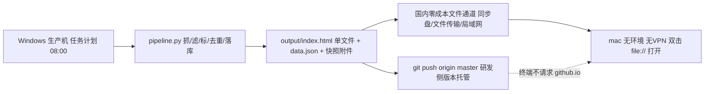
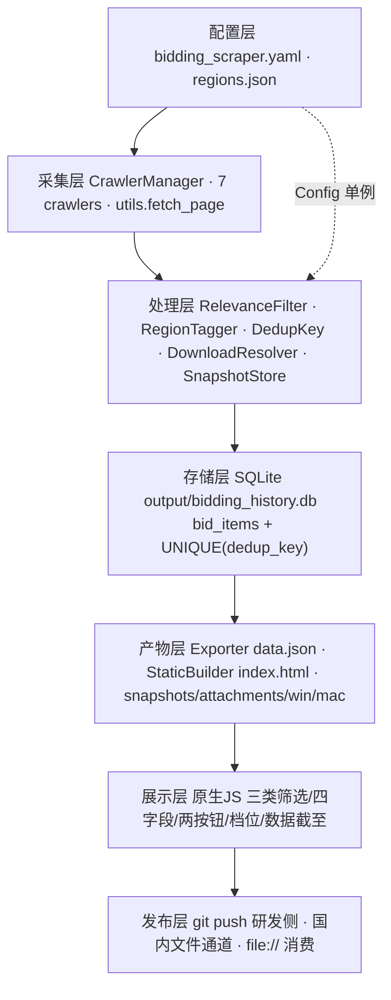
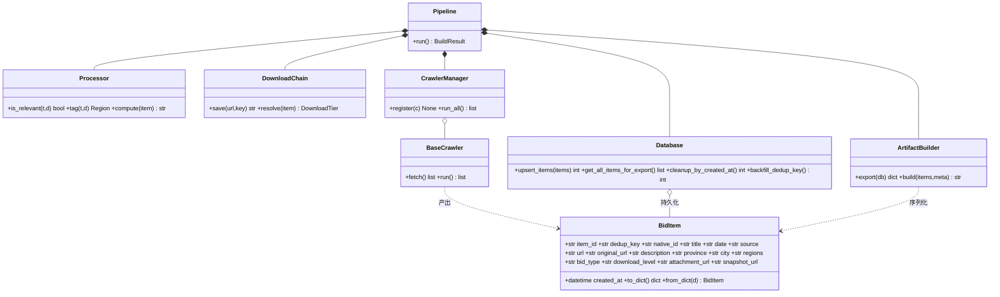
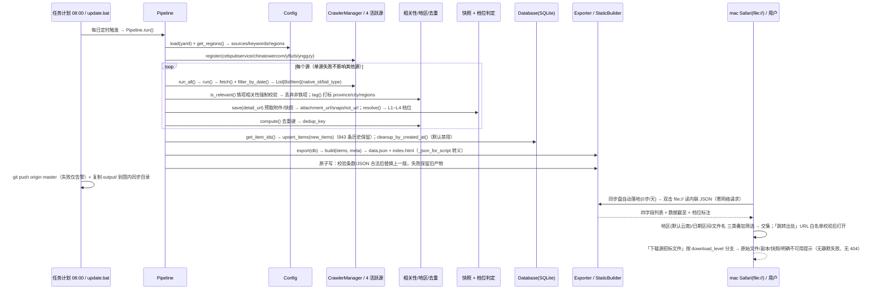

# 铁塔招标信息聚合应用 · 系统架构设计与任务分解
> v1.0 ｜ SOP 第 2 阶段 ｜ 高见远（架构师）｜ 输入 `docs/PRD.md`（许清楚）+ 全仓 52 文件实读 ｜ 与 PRD 冲突处**以本文为准**
> 证据口径：**[实]**=文件/行号/命令实查；**[推]**=基于实查推断；**需验证**=未实测、不假定成立。
> 验收编号已对齐 PRD v1.0（153 行终版）：**AC-01~AC-12、FR-01~FR-14**；本文不再引用中间稿编号。
## 0. 实查事实补充（PRD 之外的新证据）
| # | 结论 | 证据 |
|---|---|---|
| A1 | `.gitignore:2` 已忽略 `dist/` → 产物用 `dist/` 将**推不上仓库**，故复用已入库的 `output/`；`is_notified` 仅建表无读取、`pytz` 在 `*.py` 零引用、`config.yaml:253` 明文真实 token 存在 | [实] `.gitignore:2`、`git ls-files`=52、`database.py:43`、Grep |
| A2 | `get_all_items(limit=100)` 且 `main.py:165` 无参调用 → 843 条历史 RSS 只出 100 条，静默丢数据（PRD 未列） | [实] `database.py:180`、`main.py:165` |
| A3 | `filter_items` 全仓仅 `ynggzy.py:40` 调用、`filter_by_region` 只在注释出现 → 活跃源相关性/地区**零处理**；`crawlers/__init__.py:4-9` 导出 6 类但无 `YnggzyCrawler`，`main.py:20-27,42-58` 无导入/无注册分支 → 零注册 | [实] Grep、`cebpubservice.py:165`（注释） |
| A4 | 通知残留分布 8 文件；`deploy.yml:1-31` 仅纯静态部署、`:33-84` 抓取段全注释、无 schedule | [实] Grep + Read |
| A5 | 历史库 843 条/2 源/`date 2026-07-07~2026-08-01`/`created_at 2026-07-20~2026-08-02`；HEAD `8233782` 提交于 2026-08-02 | [实] sqlite3、`git log -1` |
| A6 | PRD「日期上界疑似未来」：结合 A5 的 created_at/HEAD 时间，[推] 2026-08-01 对运行日合理；脏数据仍**需验证** | 需验证 |
## 1. 最终选型结论（逐条正面回应 4 大挑战）
### 1.1 结论
**选定「网页形态」——准确说是「离线优先（Offline-First）的零构建纯静态 HTML + 数据文件」；不采用安装包，也不采用混合形态。** 筛选/四字段/两按钮本质是页面交互，一份 HTML 原生支持；本机 Windows 无 macOS/Xcode/签名公证（主理人实测硬事实，PRD §3/T3），无法产出可用 mac `.app`；离线单文件 `file://` 双击即用，零安装、零翻墙、零网络请求；每日重生成即全员生效。**关键修正：不把「国内可直连在线托管」当前提**——用户未提供任何托管账号/域名/服务器，github.io 明确需翻墙，GitHub raw / jsDelivr / Gitee Pages 国内可达性**均需验证**；故 PRD §2.2 的「国内可直连静态托管」分支在现有资源下**不成立**，降级为 §1.2 文件级数据通道闭环。
### 1.2 挑战 1｜落地闭环（零成本 / 零环境 / 免翻墙 / 每天更新 / 推送原仓库）
> **硬约束先讲清**：在「无任何服务端与托管账号」下，「mac 零操作且每天自动见新数据」物理上不成立——信息必须有一条生产端→终端的国内通道；用户已确权的通道只有 GitHub 仓库（但终端不得访问）。故用**文件级通道**替代在线托管，不假定任何第三方服务。

| 环节 | 落地做法 | 证据/口径 |
|---|---|---|
| 生产 | Windows 任务计划每日 08:00 触发 `update.bat` → 抓取→处理→落库→生成 `output/index.html`（数据安全内联，零外部请求） | [实] `README.md:114`、`update.bat:10-38` |
| 研发侧托管 | `git add output/` + `git push origin master`，满足「推送回原仓库」；**终端入口与仓库完全解耦**，全流程不请求 github.io / github.com | [实] `update.bat:29-33`；写权限未实测见 §10 |
| 国内通道 | **同一份 `output/`** 同时复制到用户既有、零额外成本通道：坚果云/百度网盘/阿里云盘同步盘、微信文件传输助手、局域网共享、U 盘（已定案：同步盘默认 + 手动覆盖兜底，用户无需单选）；同步盘客户端是用户日常工具，**不是本项目要求安装的开发环境** | 已定案，按现状推进 |
| 消费 | mac 收到 `index.html` → 系统 Safari/Chrome 双击 `file://` 打开，显示全量数据 + 「数据更新时间 / 数据截至」 | [实] `serve_web.py:458-471` 已具静态生成能力 |
| 每日更新步数 | **同步盘：0 步/天**（Windows 生成即自动同步，mac 仅刷新已开页面，页内 `visibilitychange` 提示「数据截至已更新」）；**手动通道：1 步/天**（取文件覆盖+刷新）；首次 1 步（加书签/Dock） | [推] |
| 取舍 | 代价：新鲜度取决于取文件时机，用醒目「数据截至 YYYY-MM-DD」+ 超 2 天标黄替代推送（本期本就不做推送）；收益：零账号、零费用、零翻墙、断网可用 | — |
**L1 可选增强（不进本期基线、需验证）**：若用户日后提供 Gitee Pages / 国内对象存储静态站 / 家庭 NAS HTTP / 局域网 Windows 静态服务，可部署 `index.html`+`data.json` 分离版，打开书签每天刷新即最新（真正 1 步在线）；**任何在线入口均不作为 AC-01/AC-11 验收基线**。
### 1.3 挑战 2｜win/mac 用户可感知的版本区分
PRD 弱化为「同一 URL + OS 自适应」不满足用户「做好版本区分」。改为**同一份数据产物 + 平台专属入口与包**：
| 维度 | Windows | macOS | 可感知点 |
|---|---|---|---|
| 一键入口 | `update.bat`（生产端：抓取+生成+推送+同步复制） | `打开_mac.command`（仅 `open ./output/index.html`，**零依赖、不调用 python**） | 文件名/图标/双击行为不同 |
| 离线快照包 | `output/win/` + `使用说明_win.txt`（Chrome/Edge 双击即可） | `output/mac/` + `使用说明_mac.txt`（Safari/Chrome、`file://` 限制、Gatekeeper 右键→打开） | 各自目录与说明文档 |
| 中文文件名 | `<a download>` + `Content-Disposition` | Safari 对 `download` 支持有差异 → 降级「新标签打开 + 引导另存为」；L1/L2 用 `fetch+Blob` 重命名，统一 UTF-8 `filename*`(RFC 5987) | 下载行为按 OS 分支 |
| 安全策略 | 直接运行 .bat | `.command` 首次需 `chmod +x`、未签名脚本可能被 Gatekeeper 拦截 → 说明「右键→打开」；**最稳路径是根本不用脚本，直接双击 index.html** | 首次打开提示 |
**为何优于两份二进制**：无法交叉编译 mac .app（T3 硬事实）；双二进制需签名/公证/升级通道、维护成本最高；离线包与「每天更新」天然冲突；用户操作从 1 步变 ≥4 步。上述 4 项在**零构建**下即可让用户明确感知平台差异，且数据/逻辑完全同源。
### 1.4 挑战 3｜技术栈取舍（明确不套默认栈）
| 维度 | Vite+React+MUI+Tailwind（团队默认） | **零构建纯静态 HTML + 原生 JS（选定）** |
|---|---|---|
| `file://` 打开 | ES module / `fetch('data.json')` 被 Chrome CORS 拦截；chunk 相对路径易失效 | 数据内联进 HTML，零请求，双击即用 |
| 构建在哪做 | 需 Windows `npm run build` → `dist/` 再同步到 mac（且 A1：dist 被 `.gitignore` 忽略） | 无需构建；Python 直接渲染模板 |
| 终端依赖 | 需保证产物完整、无 CDN（MUI/Tailwind 常引外部资源） | 原生 ES2015，Safari/Chrome/Edge 均支持，零 CDN |
| 规模适配 | 私人小工具仅「筛选+列表+两按钮」 | 足够，且无 node_modules / 打包链 |
**结论：放弃默认栈**，数据侧沿用 Python + SQLite（已有 843 条资产与 7 个 crawler），前端零框架零依赖零构建；Node 本机可用但**不进入交付链**。若未来必须构建，需先解 A1 的 `.gitignore` 与 `file://` CORS 两处，得不偿失。
### 1.5 挑战 4｜每日更新的执行位置与失败降级
| 项 | 现状证据 | 目标设计 |
|---|---|---|
| 执行位置 | [实] `README.md:114`「git 代理时无法访问」、`deploy.yml:33-84` 抓取段整段注释、`update.bat:10-38` 本机跑 | **仅 Windows 生产机**（唯一具备国内网络+可装 Python 依赖+已配 git 凭据）；终端 mac **绝不承担抓取** |
| 触发 / 境外 CI | 无 schedule（`deploy.yml:3-7`）；`deploy.yml` 绑定 GitHub Pages 但终端已不用 | Windows 任务计划每日 08:00 (Asia/Shanghai) → `update.bat`，支持手动双击；**删除该 workflow**（保留会误导且违背「终端不请求 github.io」），抓取职责永不回流 CI |
| 单源失败 | `base_crawler.py:153-160` 已有逐源 try/except | 沿用；`CrawlerManager.run_all` 保证单源失败不影响其他源，产物附 `source_health` |
| 全失败降级 / push 失败 | 无；`update.bat:34-38` 直接报错退出 | **原子写+校验**：新产物写临时文件，校验条数/JSON 合法后才替换，失败保留上一版并显示「数据截至上次成功时间」；push 失败**仅告警不阻断**，本地/同步目录产物照常可用 |
## 2. 分层架构

**关键约束**：处理层「相关性过滤」与「地区打标」**必须解耦**——相关性=强制 `keywords.core/industry` 校验（不要求云南），地区=只打标不过滤。现状 `filters.py:24-58` 的 `require_yunnan=True` 默认值会砍掉全部全国数据，与「全国全量入库+云南优先视图」冲突，故不直接复用其默认值。
## 3. 完整文件清单（新增 / 修改 / 删除 三类）
| 类别 | 路径（同类合并） | 职责 / 改动 | 优先级 |
|---|---|---|---|
| 新增 | `dedup.py`/`relevance.py`/`region_tagger.py`/`download_resolver.py`/`snapshot.py`（均在 `scripts/bidding_scraper/`） | 去重键+URL归一 / 铁塔相关性强制接入 / 省+州市打标 / L1~L4 判定 / 快照附件预取 | P0（snapshot P1） |
| 新增 | `exporter.py`/`builder.py`/`pipeline.py`；`web/index.template.html`/`web/app.js`/`web/styles.css` | DB→data.json+meta+source_health / 安全内联渲染 / 全流程编排；模板 / 三类筛选+四字段+两按钮+档位 / 响应式 | P0 |
| 新增 | `config/regions.json`；`output/index.html`/`output/data.json`/`output/win|mac/`/`output/snapshots|attachments/` | 全国省份·地州市映射+云南 16 州市词表（Python/前端共用）；单文件离线页 / 分离数据 / 各平台快照包+中文说明 / L2·L3 产物（按 dedup_key 命名） | P0（win|mac P1） |
| 新增 | `打开_mac.command`；`tests/test_{dedup,relevance,region,cleanup,builder_xss,download_tier}.py`+`conftest.py`；`docs/使用说明.md` | mac 零依赖一键打开 / 最小回归集 / 面向用户的 win/mac 操作说明 | P0 |
| 修改 | `config/bidding_scraper.yaml` | **删** `notification`(含 :253 明文 token)、`schedule`、`chinabidding`；**增** `relevance.require_core=true`/`download.*`/`publish.*`/`offline.stale_days=2`/`cleanup.enabled=false`；`ynggzy` 保持 enabled | P0 |
| 修改 | `models.py` / `database.py` | `BidItem` 扩字段（§4）、`to_dict/from_dict` 同步、去掉 `md5(title_url)`；schema 迁移+`UNIQUE(dedup_key)`、`cleanup_old_items`→`cleanup_by_created_at`(默认禁用)、新增 `upsert_items`/`get_all_items_for_export`（**去掉 :180 的 100 条截断**）/`get_source_health`/`backfill_dedup_key` | P0 |
| 修改 | `filters.py`/`base_crawler.py`；`crawlers/__init__.py`+`{cebpubservice,chinatowercom,yfbzb,ynggzy}.py` | `should_include` 改 `require_core` 语义、`RegionFilter` 改打标器；`run()` 在 `fetch()` 后串接 relevance→region→download→dedup 保证活跃源真正接入、日期不可解析标 `date_valid=false`；导出 `YnggzyCrawler`，补 `native_id`(businessId/infoid/bulletinid)/`bid_type`/附件快照 URL，定位 yfbzb 0 条原因 | P0 |
| 修改 | `{ccgp,tower_com_cn,miit_txzbqy}.py`；`main.py`/`config.py` | P1 复测后按配置启用、最小改动，不通过则保持 disabled 并写结论；删 `:29,117-162` 通知分支与 `get_notification_config`(:133-155)，注册 `ynggzy`、改调 `Pipeline.run()`，新增 `get_download_config`/`get_publish_config`/`get_regions` | P0（休眠源 P1） |
| 修改 | `serve_web.py` / `output.py` | **重写为薄封装**：仅留本地 http.server 预览供 Windows 调试，删 `:315-322` 公告类型筛选控件与 `:447,461` 不安全内联、生成职责移交 `builder.py`；RSS 保留(FR-14)改从 exporter 取全量，`escape`(:82) 已安全 | P0 / P2 |
| 修改 | `update.bat` / `README.md` / `.gitignore` / `requirements.txt` / `pyproject.toml` / `docs/PRD.md`(PM 已完成，勿改) | 重写：抓取→生成→push(失败仅告警)→复制到同步目录，删 `:42`「GitHub Actions 将自动部署」；删 `github.io`(:74)/「每日 11:00」/推送配置段(:19,83-92)/Linux-Mac crontab(:98-104)，改写离线优先闭环+win/mac 对照+更新落 Windows；忽略 `*.log`/`snapshots/`/`attachments/`，**保留 `*.db`/`index.html`/`data.json` 入库**；加 `pytest`(dev extra)、删疑似未用 `pytz`（需验证）、`requires-python` 对齐 3.13；PRD 附录 A（形态裁定对齐）**已由 PM 落盘，工程师不得再改 PRD** | P0 |
| 删除 | `notification/`(6 文件)、`旧推送脚本`；`output/html/`(3)、`output/news/`(9)、`output/rss/`(2)、旧 `output/index.html` | 本期不做推送，彻底移除通知链路与残留；TrendRadar 遗留死产物（14/17），旧页面含 XSS 内联 | P0 |
| 删除 | `.github/workflows/deploy.yml`；配置内 `notification`/`schedule`/`chinabidding` 段 | 绑定 GitHub Pages 终端已不用，保留会误导且违背 AC-11；明文 token 与推送残留、废弃源 | P0 |
> **安全动作（非代码）**：`:253` 的真实机器人推送凭据已进入 git 历史，仅删文件不够，需主理人去对应平台后台**作废该机器人凭据**。
## 4. 数据结构（选 SQLite 为唯一事实源）
**选型说明**：已有 843 条历史库与去重/增量/清理需求，SQLite 是权威存储；`data.json` 只是 DB 的序列化产物，**不另定义 JSON schema**，避免两套模型漂移。字段覆盖：文件名/日期/来源/摘要/原文 URL/地区(省+州市)/公告类型标签/下载档位/附件或快照 URL/去重键/采集时间。
```sql
CREATE TABLE bid_items (
  item_id TEXT PRIMARY KEY,  dedup_key TEXT NOT NULL UNIQUE,  native_id TEXT,  -- 源站主键 businessId/infoid/bulletinid
  title TEXT NOT NULL,  date TEXT NOT NULL,  date_valid INTEGER DEFAULT 1,  -- 公告日期 YYYY-MM-DD
  source TEXT NOT NULL,  url TEXT NOT NULL,  original_url TEXT DEFAULT '',  -- 原文 URL（出处按钮）
  description TEXT DEFAULT '',             -- 摘要
  province TEXT DEFAULT '',  city TEXT DEFAULT '',  regions TEXT DEFAULT '[]',
  bid_type TEXT DEFAULT '',                -- 公告类型：仅标签，不过滤
  download_level TEXT NOT NULL DEFAULT 'L4',  download_note TEXT DEFAULT '',  -- L1|L2|L3|L4
  attachment_url TEXT DEFAULT '',  snapshot_url TEXT DEFAULT '',  -- L1 直链/L2 预存/L3 快照相对路径
  created_at TIMESTAMP DEFAULT CURRENT_TIMESTAMP,  collected_at TIMESTAMP DEFAULT CURRENT_TIMESTAMP  -- 采集时间（清理唯一口径）
);
CREATE INDEX idx_date ON bid_items(date DESC); CREATE INDEX idx_source ON bid_items(source);
CREATE INDEX idx_created_at ON bid_items(created_at); CREATE INDEX idx_province_date ON bid_items(province, date DESC);
```
**去重键（修 `models.py:26-27` 的 `md5(title_url)`）**：现实现对标题微小差异（高亮 `<em>`、空格、`[招标公告]` 前缀）与 URL 变体（fragment/尾斜杠/跟踪参数）敏感，语义同文却重复入库。新规则 `dedup_key = sha256(normalized(source) + "|" + (native_id or canonical_url) + "|" + date)[:32]`；`canonical_url`=小写 host、去尾 `/`、去 `utm_*`/`timestamp`、保留 SPA fragment 中的业务 ID（如 `#/bulletinDetail?uuid=`）；`native_id` 优先，无则回退 `canonical_url`；老数据用 `backfill_dedup_key` 一次性回填（title 去 HTML 标签/`[类型]` 前缀后归一），**保留全部 843 条**。

## 5. 模块接口契约（关键签名）
| 模块 | 签名 | 契约 |
|---|---|---|
| `dedup` | `normalize_url(url: str) -> str`；`compute(item: BidItem) -> str` | 纯函数无 IO，同语义必同键 |
| `relevance` | `is_relevant(title: str, description: str = "") -> bool` | `require_core=true` 时标题/摘要须命中 `keywords.core` 或 `industry`；**不要求云南** |
| `region_tagger` | `tag(title: str, description: str = "") -> Region` | 返回 `{province, city, regions[]}`；标题优先、正文回退；**只打标不丢弃** |
| `download_resolver` | `resolve(item: BidItem) -> DownloadTier` | 返回 `{level: L1|L2|L3|L4, url, filename, note, enabled}`；L4 时 `enabled=false`，**不得伪造文件** |
| `snapshot` | `save(detail_url: str, dedup_key: str) -> str` | 抓取失败返回 `""`，由 resolver 降级到 L4 |
| `database` | `upsert_items(items) -> int`；`cleanup_by_created_at() -> int`；`get_all_items_for_export() -> list[BidItem]` | 全量导出无截断；清理仅按 `created_at` 且默认禁用 |
| `exporter` / `builder` | `export(db: Database) -> dict`；`build(items: list[dict], meta: dict) -> str` | 前者含 `generated_at`/`data_as_of`/`items[]`/`source_health[]`；后者内联数据经 `_json_for_script()` 转义，`file://` 零请求 |
| `pipeline` / `serve_web` | `run() -> BuildResult`；`build_html(output_path, days)` / `main()` | 编排全流程、失败保留上一版产物（原子写）；serve_web 仅薄封装转调 `builder.build()` |
| `web/app.js` | `applyFilters(state) -> Item[]`；`renderDownload(item) -> Node` | 三类筛选取交集；无类型筛选控件 |
## 6. 程序调用流程（Mermaid 时序图）

## 7. 有序任务列表（工程师直接输入 · 5 任务上限）
阶段映射：`基础设施`→T01，`数据层`→T02，`采集层`→T03，`产物层+前端`→T04，`启动脚本/文档+测试`→T05；依赖链 `T01→T02→T03→T04→T05`（T03/T04 主要依赖 T01+T02，T05 需全链路就绪）。
| ID / 任务名 | 依赖 / 顺序 / 优先级 | 涉及文件 | 验收要点 |
|---|---|---|---|
| **T01 项目基础设施与安全清理** | 无 / 1 / P0 | `config/bidding_scraper.yaml`、`config/regions.json`、`requirements.txt`、`pyproject.toml`、`.gitignore`、`config.py`、`main.py`(入口骨架)、`deploy.yml`(删)、`notification/`(删)、`旧推送脚本`(删) | 仓库 grep 无推送凭据相关英文关键词残留；通知目录与 deploy.yml 已删；`pytest --collect-only` 可用；`Config.load()` 加载新键不报错；`output/` 死产物 14 项已清 |
| **T02 数据层（模型/库/去重/相关性/地区）** | T01 / 2 / P0 | `models.py`、`database.py`、`filters.py`、`dedup.py`(新)、`relevance.py`(新)、`region_tagger.py`(新)、`tests/test_{dedup,relevance,region,cleanup}.py` | schema 含 §4 全字段 + `UNIQUE(dedup_key)`；843 条老数据回填后无损；同文不同 URL 变体→同键；非铁塔标题被剔除；云南 16 州市→`province=云南`；40 天前公告但 `created_at` 今日的记录**不被清理**；`get_all_items_for_export()` 返回 843 而非 100 |
| **T03 采集层（活跃源接入 + 休眠源注册 + 下载档位/快照）** | T01, T02 / 3 / P0/P1 | `base_crawler.py`、`crawlers/__init__.py`、`crawlers/{cebpubservice,chinatowercom,yfbzb,ynggzy,ccgp,tower_com_cn,miit_txzbqy}.py`、`download_resolver.py`(新)、`snapshot.py`(新)、`main.py` | `YnggzyCrawler` 已导出且注册（AC-07 由 0 条→>0 条）；活跃源 `run()` 后必过相关性+打标+档位；每条有 `native_id/bid_type/download_level`；单源异常不影响其他源；yfbzb 0 条给出明确结论；3 个休眠源复测后配置化启用或写明降级原因（P1） |
| **T04 产物层 + 前端（导出/安全构建/页面）** | T01, T02（数据契约就绪即可并行）/ 4 / P0 | `exporter.py`(新)、`builder.py`(新)、`pipeline.py`(新)、`output.py`、`serve_web.py`、`web/index.template.html`、`web/app.js`、`web/styles.css`、`output/index.html`、`output/data.json`、`output/win|mac/` | `file://` 双击打开零报错零外部请求；三类筛选可叠加为交集；默认云南优先可切全国；四字段齐全且缺失有占位；**无公告类型筛选控件**；每条两按钮+档位可见；L1~L4 各 ≥1 样本无 404/静默失败；页面显示「数据更新时间 / 数据截至」；注入 `<script>alert(1)</script>` 与 `</script><script>alert(2)</script>` 均按文本显示（AC-10）；全失败时保留上一版产物 |
| **T05 启动脚本 / 文档 / 测试与回归** | T01–T04 / 5 / P0 | `update.bat`、`打开_mac.command`、`README.md`、`docs/使用说明.md`、`docs/PRD.md`(PM 附录 A 已完成，勿改)、`tests/test_{builder_xss,download_tier}.py`、`tests/conftest.py` | Windows 任务计划配置说明完整；`update.bat` push 失败仅告警、产物照常生成；mac `.command` 零依赖（不调用 python）且含 Gatekeeper 说明；README 无 github.io/每日 11:00/飞书/crontab-mac 残留；`pytest` 全绿（≥6 用例）；win/mac 中文文件名下载不乱码（AC-01） |
## 8. 依赖包与共享约定
**运行时（仅 Windows 生产端）**：`requests`(HTTP)、`PyYAML==6.0.3`、`beautifulsoup4==4.12.3`+`lxml==5.3.0`(HTML)、`tenacity==8.5.0`(`utils.py:13` 重试)；标准库 `sqlite3/json/hashlib/html/datetime/argparse/http.server`。**不引入** Vite/React/MUI/Tailwind/Node/PyInstaller；`pytz`(:2) 疑似未用，实施时 grep 确认后删（需验证）。**开发测试**：`pytest`(+可选 `pytest-cov`)；主理人实测本机 Python 3.13.14 / pip 可连 pypi 与清华镜像，安装无障碍。
| 约定 | 内容 |
|---|---|
| 配置键 | `sources.*.enabled`、`keywords.core/yunnan/industry`、`filter.days_limit`、`database.path`、`database.retention_days`、`cleanup.enabled=false`、`relevance.require_core=true`、`download.*`、`publish.*`、`offline.stale_days=2`；**删除** `notification.*`、`schedule.*` |
| 字段命名 / 地区词表 | Python/DB/`data.json` **统一 snake_case**（前端直接消费，不做 camelCase 转换），避免现 `serve_web.py:227` 的 `bidType/regions` 两套并存；单一事实源 `config/regions.json` 合并 `config.yaml:57-74`（云南 16 州市）与 `serve_web.py:32-143`（PROVINCES + CITY_TO_PROVINCE），Python 打标与前端下拉共用 |
| 下载档位枚举 / 路径 | 字符串 `L1|L2|L3|L4`；文案：原始文件 / 源文件副本 /「原站未提供文件下载，以下为详情页快照」/「该来源不提供下载，请前往出处查看」；L4 按钮禁用；产物**统一 `output/`**（A1：不可用 `dist/`），`*.db`/`index.html`/`data.json` 入库，`snapshots/`/`attachments/`/`*.log` 忽略，快照附件按 `dedup_key` 命名；`update.bat` 读环境变量 `BIDDING_SYNC_DIR`（同步盘内 output 目录）自动复制产物，未设置则跳过、走手动通道 |
| 时间 / URL | 全部 ISO 8601 + `Asia/Shanghai`；`date`=公告日期，`created_at/collected_at`=采集时间，`generated_at`=产物生成时刻，`data_as_of`=本次成功采集最晚公告日；URL 白名单仅 `http/https`，所有外链 `target="_blank" rel="noopener noreferrer"` |
## 9. 安全与质量落地
| 项 | 缺陷证据 | 落地动作 |
|---|---|---|
| XSS | `serve_web.py:447,461` 把 `json.dumps` 直接内联进 `<script>`，`</script>` 可闭合注入；前端 `esc()` 挡不住 | `builder._json_for_script()` 转义 `< > &`→`\u003c/\u003e/\u0026`、U+2028/2029；数据放 `<script type="application/json" id="DATA">` 用 `JSON.parse(textContent)`；渲染用 `textContent`/`createElement` 而非拼 `innerHTML`（现 `render()` 用 innerHTML+esc，收紧） |
| URL scheme / 无通知残留 | 无 URL 校验；`config.yaml:250-259`、`main.py:117-162`、`config.py:133-155`、8 个文件 | 生成期与前端双校验仅 http/https、非法 URL 按钮禁用；通知链路全删 + grep 门禁（AC-09），**另需对应平台后台作废真实凭据** |
| cleanup | `database.py:213-228` 按**公告日期** `DELETE WHERE date < cutoff`，`retention_days:30` 且每次运行执行 → 历史被清空 | 改 `cleanup_by_created_at()`，**默认禁用**、全量保留；回归用例：老公告日期 + 今日 created_at 不删 |
| 最小测试 | 全仓 0 测试 | pytest 6 类：去重归一、相关性接入、地区打标、cleanup 回归、XSS 双注入、L1~L4 档位；`pytest` 全绿即满足 AC-12 |
## 10. 待明确事项（附建议主理人替用户做的合理假设）
| # | 事项 | 建议假设（不阻塞开工） |
|---|---|---|
| Q1 / Q2 | 用哪个国内文件通道？是否提供国内静态托管/Gitee Pages？ | 假设用**同步盘**（坚果云/百度网盘等免费同步文件夹）故每日 0 步；若用户不确定，按「手动 1 步覆盖文件」交付，通道选择不影响任何代码；假设**本期不提供**在线托管，在线书签列为 L1 可选增强，Gitee Pages 实名/审核、jsDelivr/GitHub raw 国内可达性**需验证**，不写进基线；PM 附录 A 另提验收口径调整（AC-01 首次一次性配置通道、AC-08 验产物文件、AC-11 重点验「数据截至+超 2 天标黄」）已批准；通道**已定案：同步盘默认（0 步/天）+ 手动覆盖兜底（1 步/天）；本期不提供在线托管**，架构侧 L0 闭环已天然满足，无需改设计 |
| Q3 | GitHub 仓库写权限 | `git push --dry-run` 返回 up-to-date、exit=0 但**不触发真实写入认证**；建议实施阶段实跑一次 push 验证；若失败，离线产物与同步通道仍完全可用，不阻塞 |
| Q4 | 各源当前可用性 | cebpubservice 老站 API、chinatowercom、yfbzb(0 条原因)、ynggzy、3 个休眠源（「严格反爬」/「连接超时」/「SPA 待逆向」）**均需验证**；实施先跑单源探针，失败即配置化降级，不引用任何第三方平台能力/价格断言 |
| Q5 / Q6 | 历史日期脏数据 / 是否需完全断网 | A5/A6 按运行日校验 `2026-08-01` 上界与 `date_valid`，不删老数据；假设无需完全断网（PRD Q4），但 L0 基线 `file://` 天然满足断网（AC-11 免费通过） |
| Q7 | token 泄露处置 | 需主理人去对应平台后台作废 `0333ed93-…` 对应的机器人推送凭据（代码删除不能撤销已泄露凭据） |
