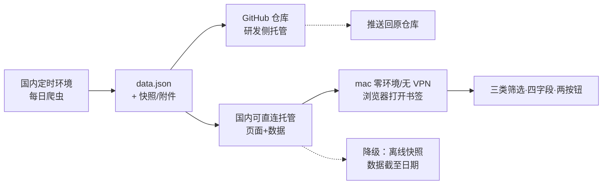

# 铁塔招标信息聚合应用 · 重构 PRD
> v1.0 ｜ 标准 SOP 第 1 阶段 ｜ 撰写：许清楚（产品经理）｜ 读者：架构师 / 开发 / QA｜本文只给需求侧结论，**形态与技术最终选型由架构师裁定**；证据均来自本地仓库实读，未核实项标注「需验证」。
> **实施注（SOP 第 3 阶段 · 工程师）**：最终形态与技术选型以 `docs/ARCHITECTURE.md` 裁定为准——离线优先的零构建纯静态 HTML + 数据内联；本文仅记录需求侧结论，冲突处以 ARCHITECTURE 为准。

## 项目信息
| 项 | 内容 |
| --- | --- |
| Language / Project Name | 简体中文 / `tower_bidding_aggregator` |
| Programming Language | 前端建议 Vite + React + MUI + Tailwind CSS（团队默认栈）；数据侧沿用 Python 爬虫 + SQLite；最终由架构师定 |
| 目标仓库 / 本地工作目录 | `https://github.com/zero01221/BiddingInformation`（代码与数据产物推送回原仓库）/ `D:/AAAProject/AAAgithub/BiddingInformation` |
| 原始需求复述 | ①主源=中国招标投标公共服务平台、另两源为辅，优先云南，可扩充热门铁塔招投标网站；②评估「网页/安装包」形态，硬约束：无开发环境 mac 能打开、不用 VPN、解决 GitHub Pages 需翻墙、做好 win/mac 版本区分；③地区/日期/文件名三类筛选，保证「铁塔方面」但公告类型不过滤，列表显示文件名/日期/来源/摘要，每条两按钮（跳转出处、下载源招标文件，需降级）；④其余沿用原软件目的，消息推送本期不做、信息全部放页面；⑤做完后推送回原仓库 |

## 0. 现状核实（证据）
| # | 结论 | 证据 |
| --- | --- | --- |
| 1 | README 宣称「每日 11:00 自动更新」并给出 github.io 地址，但 CI 无 schedule、抓取+生成 HTML 整段被注释，仅剩纯静态部署；实际更新靠 Windows 本机 `update.bat`（跑爬虫→生成 HTML→git push），原因写明「使用 git 代理时无法访问」国内平台 | `README.md:74,114-120`；`.github/workflows/deploy.yml:3-7,33-84`；`update.bat:10-38` |
| 2 | 配置 8 源：enabled 4（cebpubservice/chinatowercom/yfbzb/ynggzy）、disabled 4（ccgp/tower_com_cn/miit_txzbqy/chinabidding）；`main.py` 仅 6 个注册分支、**运行时实际装配 3 个**（enabled ∩ 有分支） | `config/bidding_scraper.yaml:95-226`；`main.py:20-27,42-58`；`config.py:90-97` |
| 3 | 休眠源均有完整实现+禁用原因注释（「严格反爬」/「连接超时」/「SPA 待逆向」）→ **复用修复比重写划算**；`ynggzy` 实现完整（130 行）、配置启用，却因 `__init__.py` 未导出、`main.py` 无分支而**零注册** | `config.yaml:99,163,181,217-220`；`crawlers/__init__.py:4-9`；`crawlers/ynggzy.py:16-42` |
| 4 | 历史库实测 **843 条**，仅 2 源有数据（公共服务平台 159 / 铁塔电子采购 684），乙方宝、云南均 0 条；日期 `2026-07-07~2026-08-01`（上界疑似未来日期，字段可靠性**需验证**） | 本地 sqlite3 查 `output/bidding_history.db` |
| 5 | `filters.py` 关键词/地区过滤在活跃源**零调用**：全 `crawlers/` 仅 `ynggzy.py:40` 调 `filter_items`（且未注册）、`filter_by_region` 只有注释；活跃源只调 `filter_by_date` → **铁塔相关性入库前无过滤保证** | `filters.py:14-122`；`cebpubservice.py:111,165`；`yfbzb.py:106`；`base_crawler.py:82-109` |
| 6 | 清理按**公告日期**删除且每次运行都执行，`retention_days:30` → 历史库会被逐步清空 | `database.py:213-228`；`main.py:177`；`config.yaml:243-245` |
| 7 | 静态 HTML 把全量数据 `json.dumps` 直接内联进 `` 注入） | `serve_web.py:334,409,447,461` |
| 8 | 即时通讯机器人推送凭据明文硬编码（真实凭据）、通知链路贯穿主流程；页面还有「公告类型」筛选控件（与本期「不过滤」冲突）；数据模型无附件/地区/类型字段 | `config.yaml:250-259`；`main.py:117-162`；`serve_web.py:315-322`；`database.py:34-44` |
| 9 | `output/` 17 个文件仅 3 个为当前产物（index.html / bidding_feed.xml / bidding_history.db），其余 `news/*.db`、`rss/*.db`、`html/` 为 TrendRadar 遗留死产物；全仓 **0 测试** | 本地 Glob + Grep；`README.md:202`（提及清理 TrendRadar 但产物未删） |
| 10 | 关键词段已具 core 铁塔词表、云南 16 州市词表、industry 行业词表，可直接复用 | `config.yaml:4-92`（`core:6-54`、`yunnan:57-74`、`industry:77-87`、`days_limit:92`） |

## 1. 产品定位与目标
**一句话定位**：一个免安装、免翻墙、每日自动更新的铁塔招投标信息聚合网页 —— 在无开发环境的 mac 上打开浏览器即可按地区/日期/文件名检索、看摘要、跳原文、取源文件。

| # | 产品目标（正交） | 可度量结果 |
| --- | --- | --- |
| G1 | **零门槛可达**：不需开发环境、不装软件、不开 VPN | mac 原生浏览器 3 秒内可用，安装/配置步骤 = 0 |
| G2 | **数据可信且完整**：铁塔相关、云南优先、全公告类型、每日更新 | 误纳 ≤5%；云南源从 0 条变 >0 条；6 类公告全收录 |
| G3 | **可持续低维护**：复用已有 crawler、单一产物、双平台一致 | 复用 ≥4 个已有 crawler；win/mac 同一入口；有自动化测试 |

**User Stories**：① 作为在 mac 上看标讯的个人用户，我要打开书签就看到当天铁塔公告，不想装 Python 或开 VPN；② 作为关注云南的用户，我要默认先看云南也能切全国，并按日期/文件名快速定位；③ 作为要存档的用户，我要每条既能跳原站、又能拿到招标文件或至少一份可读快照；④ 作为维护者，我要每天自动更新、历史不被清掉、不用维护两套二进制。

## 2. 目标用户与完整闭环
**目标用户**：项目所有者本人，私人使用、无商业行为（用户已明确）。**两台终端**：无开发环境的 mac（首要）、Windows 开发机（数据生产 + 日常查看）。

**2.1 约束 → 需求逐条转换**
| 用户约束 | 转成产品需求 |
| --- | --- |
| 无开发环境的 mac | 终端不得要求 Python/Node/命令行/依赖安装；浏览器打开即用（FR-02） |
| 不使用 VPN | 终端入口不得依赖 github.io 或任何需翻墙的境外服务；「跳转出处/下载」目标站须国内可直连（FR-02/06/07） |
| GitHub Pages 需翻墙「正是要解决的问题」 | 保留 GitHub 仓库作**研发侧**代码/数据托管，**用户侧入口**迁到国内可直连位置；两者解耦（FR-02、§3 T1） |
| 每天更新 | 生产端每日定时运行，产物带时间戳；页面显示「数据更新时间 / 数据截至」（FR-01/09） |
| 不推送消息 | 移除通知链路，信息只在页面呈现，用户主动打开才看（FR-08） |
| win / mac 版本区分 | 同一 URL + OS 自适应；中文文件名两平台兼容；离线快照按 OS 分发（FR-02/10） |
| 推送回原仓库 | 研发侧交付动作，不构成终端运行时依赖（AC-11） |

**2.2 完整闭环（mac 端全程不翻墙、零安装）**

1. **生产**：每天在国内网络环境（Windows 任务计划或架构师选定的国内定时执行环境）跑一次爬虫 → 去重入库 → 生成结构化数据文件 + 详情页快照/附件。
2. **分发**：产物一份推送回 GitHub 仓库（满足「推送原仓库」），一份同步到国内可直连托管（用户侧唯一入口）；**消费**：mac 用户不开 VPN、不装任何东西，用系统自带浏览器打开书签即渲染当日数据，win 用户同一入口。
3. **降级与不推送**：托管暂不可达时打开随附的本地快照 HTML，仍可读最近一次数据并明示「数据截至 YYYY-MM-DD」；全程无任何消息推送，用户主动打开才看到更新，靠页面时间戳感知新鲜度。

## 3. 形态评估（本次重点：对比 / 推荐 / 技术矛盾）
| 维度 | 网页形式（在线静态页 + 数据文件） | 安装包形式（本地桌面应用 / .app/.exe） |
| --- | --- | --- |
| mac 零环境可用性 | ✅ 系统浏览器即用，0 安装 | ⚠️ 需 .dmg/.app + 签名公证，否则 macOS 拦截；首次仍需安装 |
| 免翻墙 | ✅ 入口放国内可直连托管（不依赖 github.io） | ✅ 本地运行，天然不需翻墙 |
| win/mac 区分 | ✅ 同一 URL 自适应 + 响应式，一份产物 | ❌ 必须产出并维护两份二进制，区分成本最高 |
| 数据更新方式 | ✅ 服务端每日重生成，用户刷新即见最新 | ❌ 需应用内联网拉取（又回到要免翻墙数据源）或用户手动重装 |
| 离线可用 | ⚠️ 需额外提供离线快照（P1 降级） | ✅ 天然离线，但数据会陈旧 |
| 打包/构建成本 | ✅ 低，仅生成静态文件 | ❌ **当前 Windows 开发环境无法本地交叉编译 mac 安装包**（无 macOS/Xcode/签名/公证），须引入 mac 构建机或 macOS CI runner |
| 维护成本 | ✅ 单产物、单发布通道 | ❌ 双平台发版、升级、签名证书 |
| 用户操作步数 | ✅ 1 步（打开书签） | ❌ 下载→安装→授权→打开→手动更新，≥4 步 |

**推荐倾向与理由**：**明确推荐网页形式（纯静态页面 + 数据文件分离，用户侧入口托管于国内可直连位置）**。它是唯一同时满足「mac 零环境 + 免翻墙 + 每天更新 + 不做推送 + win/mac 自然区分」的形态：筛选/四字段/两按钮本质是页面交互，网页原生支持；win/mac 差异退化为浏览器兼容与响应式，不需双份二进制；数据每日重生成即全员生效，不要求用户做任何操作。安装包形态在**本项目当前 Windows 单机开发环境**下几乎不可行，且「离线包」与「每天更新」天然冲突，还把操作步数从 1 步拉到 4 步以上；仅在「必须完全断网使用」时占优，而用户并未提出该硬约束。

| # | 该倾向需架构师解决的技术矛盾 | 需求侧说明 |
| --- | --- | --- |
| T1 | **GitHub Pages 需翻墙，但用户又要求推送到 GitHub 仓库** | 二者必须解耦：仓库继续承担代码/数据版本托管（研发侧，用户明确要求），**终端访问入口不得再是 github.io**；国内可直连托管的具体选型与可行性由架构师验证，PRD 不指定厂商、不预设能力 |
| T2 | **数据生产必须在国内网络** | `README.md:114` 与 `deploy.yml:33-84` 证明境外 CI 抓国内政府站不可达，原流程实际靠 `update.bat:10-38` 本机跑；每日定时落在哪由架构师定，**不得让终端 mac 承担抓取** |
| T3 | **mac 安装包无法在 Windows 本地交叉编译** | 无 macOS/Xcode/签名公证，选安装包须额外引入 mac 构建机或 macOS CI runner；这是排除安装包形态的硬事实之一 |
| T4 | 不用 VPN 也约束「跳转出处 / 下载」 | 官方源均为国内站（可行）；第三方平台若有 CDN/登录墙**需架构师验证**；不得要求用户开 VPN |
| T5 | 静态页每日更新 vs 缓存/离线；本期不做推送 vs 现存通知链路 | 数据文件版本化、缓存失效、「数据截至」提示、离线快照降级由架构师设计；`main.py:117-162` 通知分支需停用、`config.yaml:253` 明文 token 需清理并作废（安全项） |

## 4. 数据源优先级表
| 层级 | 数据源 | 现状证据 | 复用 / 新增 | 可行性风险 |
| --- | --- | --- | --- | --- |
| **主源 P0** | 中国招标投标公共服务平台 `cebpubservice` | `config.yaml:125-136` enabled；`main.py:45-46` 注册 | **复用修复**（补相关性过滤、地区打标、附件/快照抓取） | 老站 API 稳定性；全国数据需地区打标；仅国内网络可达（`README.md:114`） |
| **辅源 P0** | 中国铁塔电子采购平台 `chinatowercom` | `config.yaml:143-158` enabled；`main.py:48-49`；历史库 684 条（最多） | **复用修复** | API 稳定性需验证；主理人调研称「铁塔官方自有平台、公告最全」（需验证） |
| **辅源 P0** | 乙方宝 `yfbzb` | `config.yaml:200-212` enabled；`main.py:57-58`；**实测 0 条** | **复用修复，失败则降级** | 第三方反爬/登录；须先定位 0 条原因，需架构师验证 |
| **云南优先 P0** | 云南省公共资源交易平台 `ynggzy` | `config.yaml:217-220` enabled；`crawlers/ynggzy.py` 完整实现；**零注册、0 条** | **复用（最高性价比）**：补 `__init__.py` 导出 + `main.py` 注册分支即可 | 站点天然全云南、免地区过滤；`ynggzy.py:81-86` 已做返回结构防御，API 可用性需验证 |
| **云南 P1** | 中国政府采购网云南专区 `ccgp` | `config.yaml:101-115` disabled，`display_zone:云南 / zone_id:53` | **复用修复（启用）** | 注释「严格反爬」，需架构师验证 |
| **辅源 P1** | 中国铁塔在线商务平台 `tower.com.cn` / 工信部通信工程招投标平台 `txzbqy.miit.gov.cn` | `config.yaml:165-176` disabled「连接超时」、`183-194` disabled「SPA 待逆向」；两个 crawler 均已实现 | **复用修复（启用）** | 前者连接超时需复测、后者 Vue SPA 公开 API 待逆向；均为铁塔法定发布媒介（主理人调研，需验证） |
| **P1** | 全国公共资源交易平台 / 其他省级平台 | 无实现 | **新增（低优）** | 站点结构各异，需验证 |
| **P2 候选** | 剑鱼标讯、千里马招标网、比地招标网、标标达、火标网、必联网、采招网、六度标讯、中国采购与招标网（`config.yaml:223-225` 已禁用） | 无实现 | **新增** | 主理人调研称「数据较全、使用人数较多」（需验证）；多有登录/付费墙/反爬，**需架构师验证**；本文不引用任何价格/API/能力断言 |

> 复用判断：4 个被禁用/未注册的 crawler 恰好就是铁塔公告正文写明的法定发布媒介，**修复启用 + 补注册的成本远低于重写**，且 `ynggzy` 直接对应「云南优先」，应作为 P0 首选动作。

## 5. 功能需求池（P0 / P1 / P2）与下载降级策略
| 优先级 | ID | 需求（must / should / could） |
| --- | --- | --- |
| **P0 Must** | FR-01 | 每日定时抓取主源+2 辅源+云南源；产出结构化数据文件（文件名、日期、来源、摘要、原文 URL、地区、公告类型标签、附件信息）；SQLite 去重持久化 |
| P0 | FR-02 | **必须**在无开发环境 mac、不装依赖、不开 VPN 下浏览器打开即用；入口不依赖 github.io；win/mac 同一入口 OS 自适应，macOS Safari/Chrome 与 Windows Chrome/Edge 均可用、中文文件名下载两平台不乱码 |
| P0 | FR-03 | 三类筛选且可组合取交集：**地区**（默认云南优先、可切全国）、**日期**（区间或最近 N 天）、**文件名**（标题模糊匹配） |
| P0 | FR-04 | **铁塔相关性保证**：入库前用 `keywords.core`+`industry`（`config.yaml:6-54,77-87`）校验，且过滤必须真正接入活跃源抓取链路（现状零调用，§0-5） |
| P0 | FR-05 | **公告类型不过滤**：招标公告、开标结果、评标公示、中标公告、招标文件、开标结果文件等全收录；移除 `serve_web.py:315-322` 类型筛选控件（或仅作标签、不改变结果集） |
| P0 | FR-06 | 列表每条**必须**显示四字段：文件名、日期、来源、摘要（缺失显示明确占位）；每条「跳转出处」按钮打开原始公告页且 URL 与库中一致 |
| P0 | FR-07 | 每条「下载源招标文件」按钮，按 §5 降级表四级降级；每条可见当前降级档位 |
| P0 | FR-08 | **本期不做消息推送**：停用 `main.py:117-162` 通知链路，清理并作废 `config.yaml:253` 明文推送凭据；所有信息只在页面呈现 |
| P0 | FR-09 | 页面显示「数据更新时间 / 数据截至日期」，过期或降级时明确提示；修 XSS：内联数据转义（`serve_web.py:447,461`）、外链 `rel=noopener`；修历史清理：改按 `created_at` 与可配置策略，禁止按公告日期删除（`database.py:213-228`） |
| **P1 Should** | FR-10 | 抓取时预取附件与详情页快照提升 L2/L3 命中率；按 OS 分发**离线快照**（win/mac 各自结构与说明），断网可看最近一次数据 |
| P1 | FR-11 | 修复启用 3 个休眠官方媒介 crawler（验证通过后）；全国源自动打标省份/州市（复用 `filters.py:100-122` + `config.yaml:57-74`）支撑地区筛选 |
| P1 | FR-12 | 数据源健康可见（每源最近成功时间、条数），单源失败不影响其他源；清理 `output/` 的 TrendRadar 死产物 |
| **P2 Could** | FR-13 | 接入热门第三方平台（§4 P2 候选，需架构师验证反爬/登录墙后定）；公告类型标签与统计（仅展示不过滤）、结果导出 CSV/JSON |
| P2 | FR-14 | 保留 RSS 输出（沿用原目的 `config.yaml:268-273`）；建立自动化测试与回归（现状 0 测试） |

**「下载源招标文件」降级策略（产品定义）**
| 档 | 触发条件 | 按钮给什么 | 页面标注 |
| --- | --- | --- | --- |
| L1 | 原站提供附件直链 | 直接下载**原始招标文件**，保留原文件名 | 「原始文件」 |
| L2 | 无直链，但抓取时可解析/预存附件 | 下载应用侧预存的同名文件 | 「源文件副本」 |
| L3 | 原站不提供下载 / 需登录 | 下载抓取时保存的**详情页快照**（HTML 或纯文本） | 「原站未提供文件下载，以下为详情页快照」 |
| L4 | 连快照也拿不到 | 按钮置为明确不可用提示 + 引导点「跳转出处」 | 「该来源不提供下载，请前往出处查看」 |

> 硬规则：**不得伪造文件内容**；每条记录需持久化下载档位与产物 URL，按钮行为确定、无静默失败、无 404。

## 6. 验收标准（供 QA）
| ID | 可测条目 |
| --- | --- |
| AC-01 | 未装 Python/Node/开发工具、未开 VPN 的 mac，仅用系统浏览器打开入口，3 秒内见列表且无报错、安装步骤 = 0；同一 URL 在 Windows Chrome/Edge 功能一致，中文文件名下载两平台不乱码 |
| AC-02 | 三类筛选各自生效且可叠加：选云南后 100% 命中 `config.yaml:57-74` 词表；日期区间内结果 100% 落区间；文件名关键字 100% 命中标题；三者叠加为交集 |
| AC-03 | 抽样 100 条，铁塔相关性（`keywords.core`）命中率 100%，人工抽检误纳率 ≤5% |
| AC-04 | 构造招标公告/开标结果/评标公示/中标公告/招标文件/开标结果文件 6 类样本全部出现；页面无类型筛选控件或其不改变结果集 |
| AC-05 | 每条记录四字段齐全（缺失有明确占位）；「跳转出处」到达库中原始 URL，无错链 |
| AC-06 | 4 类降级场景各覆盖 ≥1 条样本，行为符合降级表、档位可见，无 404/静默失败 |
| AC-07 | 主源 + 2 辅源 + 云南源均有数据；**云南源 ynggzy 由 0 条变为 >0 条**；乙方宝 0 条有明确结论（修复或说明降级） |
| AC-08 | 连续两日各更新一次：时间戳递增、新增出现、历史不丢失；30 天前历史公告不被 cleanup 删除（回归 `database.py:213-228`） |
| AC-09 | 页面与代码不含任何消息推送请求；仓库不含明文 token（对比 `config.yaml:253`） |
| AC-10 | 注入 `` 与 `</script>` 标题，生成页面不执行脚本、按文本显示 |
| AC-11 | 断网打开离线快照可见最近一次数据并显示「数据截至 YYYY-MM-DD」；代码与数据产物成功推送回 `zero01221/BiddingInformation`、**终端访问全流程不请求 github.io** |
| AC-12 | 仓库中存在 ≥1 个自动化测试且通过（现状 0） |

## 7. 待确认问题（不影响开工，主理人按合理假设推进）
| # | 问题 | 合理假设 |
| --- | --- | --- |
| Q1 | 「另外两个为辅」是否指原 README 的中国铁塔电子采购平台 + 乙方宝？ | 是（`README.md:29-31`）；扩充的官方媒介归入 P1 |
| Q2 | 每日更新跑在哪？终端入口托管在哪？ | 生产留在国内网络（Windows 计划任务或架构师选定的国内定时执行环境），终端 mac 只消费产物；入口不依赖 github.io、不改用户网络设置，具体服务由架构师选型验证 |
| Q3 | 「云南优先」= 默认视图还是只抓云南？ | 默认视图优先云南，全国数据仍全量入库可切换（避免丢数据） |
| Q4 | 离线能力到什么程度？历史保留窗口？ | P1 降级（离线快照 HTML），不单独发安装包；全量保留历史，仅按 `created_at` 做可配置清理（替代原 30 天按公告日期删） |
| Q5 | 第三方热门平台本期接入？快照/附件抓取的站点限制？ | P2，待架构师验证反爬/登录/付费墙后再定；用户已明确「私人使用、无商业行为，可放心开发」，具体可行性由架构师验证，PRD 不预设第三方能力 |

## 附录 A：形态裁定对齐（第 2 阶段回填，正文编号不变）
> 依本文头部「最终选型由架构师裁定」，`docs/ARCHITECTURE.md` §1.2 将基线覆盖为「Windows 每日生成单文件离线 HTML → push 回原仓库（研发侧）+ 国内文件通道送达 → mac 双击 `file://` 打开」；原「国内可直连在线托管」降为需验证的 L1 增强、**不作验收基线**。形态与选型以 ARCHITECTURE 为准，本附录之外需求侧结论不变。
- **仍满足的硬约束 / 实现注意**：mac 零开发环境、不开 VPN、终端不请求 github.io、每天由 Windows 生成、不做推送、三类筛选/四字段/两按钮/L1~L4 降级；`file://` 单文件须内联全量数据且不得 `fetch` 外部 JSON、必须做 `</script>` 转义（呼应 §0-7、FR-09），win/mac 区分按 ARCHITECTURE §1.3 的平台专属入口与包验收（FR-02/AC-01）。
- **口径变化（需主理人确认）**：G1/AC-01 原「打开书签 1 步、安装配置 = 0」改为「首次一次性配置文件通道，此后同步盘 0 步/天或手动 1 步/天」；「每天更新」由服务端无感变为依赖该通道送达，靠页面「数据截至日期」与超 2 天标黄提示（FR-09/AC-11）。文件通道四选一（同步盘/文件传输/局域网/U 盘）**待用户确认**，合理假设先按同步盘实现。
- **编号声明**：本文唯一有效编号为 **FR-01~FR-14 / AC-01~AC-12**；202 行中间稿的 FR-18、AC-13 等旧号作废，QA 验收清单与任务分解一律以此终版为准。
